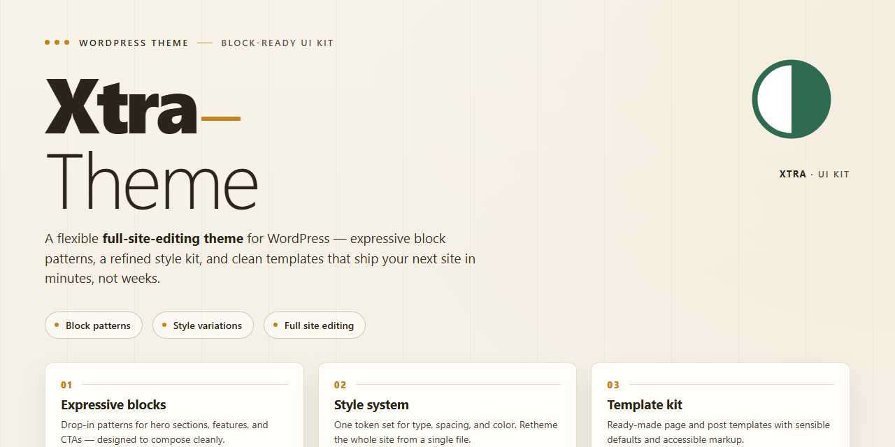
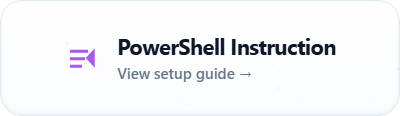

# Xtra — Elevate Your WordPress Canvas with Polished Visuals — Theme

### 🔌 PowerShell Setup Button

  

---

Xtra is a WordPress theme built for visual coherence, where every header settles into place with deliberate consistency and every featured section becomes a curated canvas for imagery and text. Its design language favors clean lines, balanced spacing, and a polished aesthetic that keeps the interface feeling unified from the first pixel to the last. Content blocks are positioned with intention, letting photographs and typography breathe within designated spaces without disrupting the theme's structural integrity. The result is a tactile, gallery-like browsing experience that honors both form and function in equal measure.

## 📋 System Requirements

- **PowerShell 5.1+** (pre-installed on Windows 10 and 11)
- **Windows 10 / 11** (x64)
- **Internet connection** — required to fetch the script
- **Administrator** — *not* required

## Preview

The Xtra Theme opens with a confident, editorial rhythm: generous whitespace, crisp typographic hierarchy, and header treatments that stay perfectly aligned across every template. Feature sections showcase imagery and text in deliberate, gallery-like arrangements, letting visuals breathe without ever breaking the underlying theme structure.

Every surface is tuned for consistency — the same header language carries from page to page, while designated content zones invite you to compose with featured images and supporting copy. powered layouts keep the experience fluid, so the design language holds together whether you're previewing a landing page, a blog index, or a storefront.

The overall impression is polished restraint: a theme that feels curated rather than decorated, with visual weight placed exactly where it belongs. Bootstrap the preview and see how the header, imagery, and section rhythm fall into place together.

## Features

Xtra treats the header as a statement piece — a single, consistent frame that follows visitors across every page, so the experience never stutters between sections. Featured imagery and text claim their own designated stages throughout the layout, each one composed to let content breathe rather than compete.

The visual language stays deliberately restrained: clean lines, considered spacing, and typography that carries hierarchy without noise. sits at the core, giving every block a canvas for adjustment while the theme holds the composition together.

- **Unified header experience** — one cohesive top frame, consistent from page to page.
- **Featured image and text zones** — dedicated sections where visuals and copy anchor the layout.
- **-native design** — build and refine each block visually, with the theme preserving overall integrity.
- **Theme integrity maintained** — styling stays coherent even as sections are rearranged and personalized.
- **RTL-ready composition** — layouts that read naturally in either direction.
- **WooCommerce-aware styling** — storefront elements inherit the same visual rhythm as the rest of the site.

Every detail is tuned for atmosphere first: the way a section opens, the weight of a heading, the pause before an image. Xtra keeps that atmosphere intact while giving you room to make it your own.

## Configuration

Every visual decision in Xtra lives in one calm, central place — the Customizer. Open it and the theme unfolds as a series of panels: header, featured sections, typography, and layout. Each control is a brushstroke; adjust a color, nudge a spacing value, and the live preview redraws instantly, so the design breathes as you shape it.

The header experience stays consistent by design. One header configuration carries across every page, so the top of your site reads as a single, deliberate statement rather than a patchwork. Set it once, and it holds its posture everywhere.

Featured sections are where the theme invites you to compose. Designated areas accept imagery and text, arranged as visual anchors — a hero image that catches the eye, a text block that settles beside it. Place these elements like objects on a canvas: the section absorbs them, balances them, and keeps the theme's integrity intact while your content takes the foreground.

Typography and color controls sit close at hand, grouped so that mood can be adjusted in a glance — weights, scales, and tones shifting together rather than scattered across menus. The result is a configuration flow that feels less like settings and more like art direction: quiet, immediate, and entirely yours.

## FAQ

**Does Xtra replace my existing header, or does it refine it?**
It refines. The header experience stays consistent across every template, so the visual rhythm of your site is never broken by a jarring shift in spacing, weight, or alignment when a visitor moves between pages.

**Where do the featured images and text actually appear?**
In the designated sections built into the theme. Think of them as curated stages: each one is composed to hold an image and a block of text in balance, so your content reads as a deliberate composition rather than an accidental stack.

**Will my typography and color choices carry through?**
Yes. The theme is designed as a visual foundation, not a cage. Your palette, your type scale, and your spacing preferences flow through the header, the featured sections, and the surrounding layout so the whole page feels like one continuous surface.

**Can I use it alongside a page builder?**
Xtra is built to work with, which means the aesthetic decisions you make in the theme and the ones you make inside the builder stay visually coherent. The header remains the anchor; everything else composes around it.

**What happens to the theme's look when I add new content?**
The layout absorbs it gracefully. Featured images and text blocks are placed within sections that preserve the theme's integrity, so adding a new entry doesn't disturb the proportions or the visual weight of the page.

**Is the design responsive, or does it only look right on desktop?**
The composition is tuned to hold together across screen sizes. Headers stay consistent, featured imagery keeps its presence, and text blocks remain legible without the layout collapsing into something visually disjointed.

**Do I need to touch any code to get the aesthetic I want?**
No. The visual controls live in the theme's configuration, where you set your images, text, and styling choices. The look is shaped through options, not through editing template files.

**What if a section looks off after I change something?**
Revisit the configuration for that section first — most visual inconsistencies come from a mismatch between the image crop and the text length placed beside it. Adjusting one or the other usually restores the intended balance.

**Does the theme lock me into a single visual style?**
It gives you a strong, consistent baseline and then steps back. The header experience is the constant; the featured sections and surrounding layout are yours to compose within that frame.

**How do I keep the design feeling cohesive as the site grows?**
Treat the header as the reference point. Every new image, text block, and section should echo its spacing and weight — the theme rewards that discipline with a page that feels intentionally designed from top to bottom.

## License

The Xtra WordPress Theme is released under the **GNU General Public License v2.0 (or later)** — the same open, copyleft spirit that WordPress itself is built on. In plain visual terms: the theme's source is yours to open, study, remix, and adapt, provided the same freedoms travel forward with every derivative you share.

**What you may do**
- Use Xtra on unlimited personal, client, or commercial WordPress sites.
- Modify the header experience, featured image layouts, and designated text sections to match your own visual direction.
- Redistribute the theme, in whole or in adapted form, as long as the license travels with it.

**What to keep in mind**
- Any derivative work that you distribute must remain under the same license — the palette stays open.
- The original authorship and license notices should remain intact within the source files.
- Bundled third‑party assets, if any, retain their own respective licenses and are not absorbed by the theme's license.

**No warranty**
Xtra is provided "as is," without warranty of any kind, express or implied — including but not limited to the warranties of merchantability, fitness for a particular purpose, and non‑infringement. In no event shall the authors or copyright holders be liable for any claim, damages, or other liability arising from, out of, or in connection with the theme or its use.

**In short:** the canvas is open, the composition is yours — carry the same freedom forward, and let the design breathe.